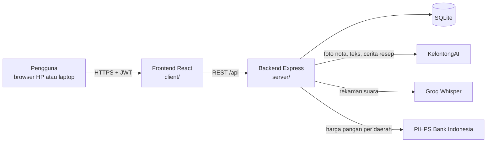
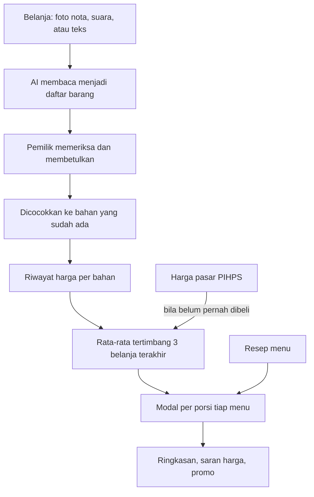

# Takarin AI

Takarin AI membantu pemilik warung dan usaha kuliner rumahan mengetahui modal setiap porsi menu (HPP), langsung dari nota belanja. Dari modal itu aplikasi menghitung harga jual minimal sesuai target untung, dan bisa menyusun paket promo yang tidak merugi.

Kategori Web, subtema UMKM. Dibuat untuk LOGICODIX 2026.

## Tim Sukses Djaya Abadi

| Nama | NIM | Peran |
|---|---|---|
| I Gede Ramadeva | 2501010025 | Ketua |
| Alan Brian Frederick | 2501010023 | Anggota |
| Ni Rai Putri Novianti | 2501010008 | Anggota |
| Ken Jatikusumo | 2501010034 | Anggota |

## Masalah yang kami angkat

Kebanyakan warung menentukan harga jual sekali di awal, lalu jarang menghitungnya lagi. Padahal harga bahan berubah tiap minggu. Cabai rawit merah di Denpasar, misalnya, naik 10,6% dalam seminggu menurut PIHPS Bank Indonesia.

Kerugiannya kecil per porsi, jadi tidak terasa. Ambil ayam geprek yang memakai 20 gram cabai rawit. Kalau cabai Rp80.000/kg, biaya cabai per porsi Rp1.600. Naik 10,6% berarti tambah sekitar Rp170 per porsi. Untuk warung yang menjual 50 porsi sehari, itu sekitar Rp255.000 sebulan dari satu bahan di satu menu, dan harga jualnya tetap.

Pemilik warung sebenarnya bisa menghitung ini. Yang membuat mereka tidak melakukannya ada tiga:

1. **Resep warung tidak memakai gram.** Takarannya sendok, siung, potong, atau "secukupnya". Kalkulator HPP dan template Excel meminta semua bahan dalam gram atau kilogram.
2. **Nota belanja hanya disimpan.** Nota ditulis tangan, disingkat ("cbe rwt 1/4"), dan satuan belinya berbeda dengan satuan resep (beli per papan, pakai per potong). Menyalinnya ke tabel tiap hari terlalu repot.
3. **Hitungan sekali tidak cukup.** HPP yang dihitung bulan lalu sudah tidak berlaku bulan ini. Selama pembaruannya harus manual, hitungan itu akan berhenti dilakukan.

Beberapa penelitian tentang UMKM kuliner menemukan pola yang sama: harga ditetapkan dengan perkiraan, dan biaya seperti gas, listrik, dan tenaga kerja sering terlewat. Sumbernya kami kumpulkan di [docs/dasar-perhitungan.md](docs/dasar-perhitungan.md).

## Solusi

Pemilik usaha cukup menceritakan resepnya sekali, lewat ketikan atau suara. Setelah itu pekerjaan rutinnya hanya mencatat belanja: foto nota, ucapkan, atau ketik. Takarin AI mencocokkan setiap barang di nota dengan bahan di resep, lalu menghitung ulang modal semua menu yang memakai bahan itu.

Kalau sebuah bahan belum pernah dibeli, aplikasi memakai harga pasar di kota usaha dari PIHPS Bank Indonesia. Kalau bahan itu juga tidak ada di data pasar (tahu, kecap, sosis, dan sejenisnya), pemilik diminta mengisi harga beli terakhirnya. Harga perkiraan itu otomatis diganti begitu belanja sungguhan dicatat.

Sasaran penggunanya pemilik warung makan, kedai minuman, katering rumahan, dan penjual jajanan yang belum memakai pembukuan digital.

## Apa bedanya dengan cara yang sudah ada

| | Template Excel atau kalkulator HPP | Aplikasi kasir dan inventori | Takarin AI |
|---|---|---|---|
| Cara memasukkan resep | Isi tabel, semua dalam gram | Isi form per bahan | Ceritakan atau ucapkan, lalu periksa hasilnya |
| Takaran sendok, siung, potong | Harus dikonversi sendiri | Umumnya harus dikonversi sendiri | Dikonversi otomatis dengan tabel URT, bisa diubah per bahan |
| Harga bahan diperbarui | Diketik ulang manual | Dari input pembelian lewat form | Dari foto nota, suara, atau ketikan bebas |
| Bahan yang belum pernah dibeli | Kosong | Kosong | Harga pasar kota dari PIHPS Bank Indonesia |
| Modal semua menu ikut berubah | Tidak, harus dibuka satu per satu | Tergantung aplikasi | Ya, setiap kali belanja dicatat |
| Saran harga jual dan promo yang tidak rugi | Tidak ada | Biasanya tidak ada | Ada, dengan batas harga minimal |
| Biaya | Gratis, tetapi semua manual | Umumnya berlangganan dan dirancang untuk usaha yang sudah memakai kasir | Hanya butuh HP dan browser |

Takarin tidak menggantikan rumus HPP yang sudah baku. Rumus yang dipakai sama dengan buku dan jurnal costing, dan semua angka uang dihitung oleh kode, bukan oleh AI. Yang berbeda adalah cara datanya masuk. AI mengubah nota, suara, dan cerita menjadi data, sehingga pemilik warung tidak perlu mengisi tabel. Hasil bacaan AI selalu diperiksa pemilik sebelum disimpan, dan kalau AI sedang tidak tersedia, semua hitungan dan isian manual tetap berjalan.

## Fitur yang sudah jalan

1. Daftar dan masuk dengan email. Ada akun demo untuk mencoba tanpa mendaftar.
2. Onboarding: jenis usaha (jenis di luar daftar diperiksa AI), provinsi dan kota, target untung, porsi per hari, hari buka per bulan, serta biaya rutin seperti gas, listrik, sewa, gaji, dan penyusutan alat.
3. Menu dan resep. Bisa diisi manual atau diceritakan lalu disusun AI. Takaran boleh memakai gram, sdm, siung, butir, potong, bungkus, atau ikat. Setiap bahan langsung menunjukkan harga yang dipakai dan asalnya.
4. Catat belanja dari foto nota, ucapan, ketikan, atau tabel. Hasil bacaan selalu diperiksa pemilik dulu. Harga yang terlalu jauh dari belanja sebelumnya atau dari harga pasar diberi peringatan.
5. Pencocokan bahan. Resep dan nota memakai aturan yang sama, jadi "cbe rwt" di nota tetap masuk ke "cabai rawit" di resep. Nama yang hanya mirip harus dipastikan dulu oleh pemilik, dan bahan yang tercatat dua kali bisa digabung.
6. Satuan kemasan. "1 papan tempe = 10 potong" atau "1 kaleng susu kental manis = 18 sdm" cukup diisi sekali per bahan.
7. Modal per porsi. Harga bahan memakai rata-rata tertimbang tiga belanja terakhir, ditambah susut bahan dan bagian biaya rutin per porsi.
8. Harga pasar dari PIHPS Bank Indonesia untuk 13 jenis bahan pokok, di tingkat kota, provinsi, atau nasional, lengkap dengan grafik 30 hari. Setiap bahan diberi arah harga (cenderung naik, turun, atau stabil) dari garis tren 30 hari, ditambah catatan bila sedang menjelang hari besar seperti Natal atau Lebaran. Ini bukan ramalan angka, dan aplikasi menyatakannya begitu.
9. Ringkasan: untung tiap menu dibanding target, catatan harian satu kalimat, dan saran harga jual yang bisa langsung dipakai.
10. Coba-coba harga jual dan takaran per menu sebelum dipakai.
11. Promo paket. Aplikasi memberi pilihan harga paket yang tidak rugi, menunjukkan berapa paket yang perlu terjual agar untung tidak turun, dan mengusulkan nama serta caption WhatsApp. Paket rugi tidak bisa disimpan.

## Teknologi

| Bagian | Yang dipakai |
|---|---|
| Frontend | React 19, Vite, React Router, Tailwind CSS 4, Recharts, Phosphor Icons, browser-image-compression |
| Backend | Node.js 24, Express 5, zod, bcrypt, jsonwebtoken, multer |
| Database | SQLite bawaan Node (`node:sqlite`) |
| AI | KelontongAI (gateway model dengan API yang kompatibel OpenAI), Groq Whisper untuk suara |
| Data luar | PIHPS Nasional, Bank Indonesia |
| Tes | Vitest, 56 tes unit dan API |

## Arsitektur



Alur data utama:



Semua angka uang dihitung oleh kode di `server/src/domain/`, bukan oleh AI. AI hanya dipakai untuk membaca masukan dan menulis kalimat. Kalau AI menulis angka yang tidak ada di hasil hitungan, kalimatnya dibuang dan diganti teks baku. Rumus lengkap beserta sumbernya ada di [docs/dasar-perhitungan.md](docs/dasar-perhitungan.md).

```
client/            frontend React
  src/pages/       halaman aplikasi
  src/components/  komponen bersama
server/            backend Express
  src/domain/      rumus murni: HPP, satuan, pencocokan nama, promo
  src/services/    akses database dan alur fitur
  src/ai/          pemanggilan model, prompt, skema hasil, contoh jawaban
  src/routes/      endpoint REST dan validasi
  scripts/         isi data demo dan impor harga CSV
  tests/           tes unit dan API
docs/              dasar perhitungan dan sumber
```

## Menjalankan di komputer sendiri

Butuh Node.js 24 (minimal 22.5, karena memakai `node:sqlite`) dan npm.

Pasang dependensi:

```bash
npm install
npm --prefix server install
npm --prefix client install
```

Salin file lingkungan, lalu isi kunci API-nya:

```bash
cp server/.env.example server/.env
```

Isi database dengan akun demo:

```bash
npm run seed
```

Jalankan untuk pengembangan. Server ada di port 3001 dan tampilan di http://localhost:5173.

```bash
npm run dev
```

Atau jalankan seperti di produksi, dengan satu port di http://localhost:3001:

```bash
npm run build
npm --prefix server start
```

Menjalankan tes:

```bash
npm test
```

### Variabel lingkungan (`server/.env`)

| Variabel | Kegunaan |
|---|---|
| `AI_MODE` | `live` memanggil model AI. `fixture` memakai contoh jawaban tanpa AI, berguna untuk tes. |
| `PORT` | Port server, bawaan 3001. |
| `JWT_SECRET` | Teks acak panjang untuk menandatangani token masuk. |
| `DB_PATH` | Lokasi file SQLite, bawaan `./data/app.db`. |
| `KELONTONG_BASE_URL`, `KELONTONG_API_KEY` | Alamat dan kunci API KelontongAI. Kuncinya wajib untuk `AI_MODE=live`. |
| `MODEL_NOTA`, `MODEL_NOTA_FALLBACK` | Model pembaca foto nota dan cadangannya, dipisah koma. |
| `MODEL_TEKS`, `MODEL_TEKS_FALLBACK` | Model untuk resep, ucapan, cek jenis usaha, promo, dan catatan harian. |
| `AI_PARALEL` | Berapa permintaan AI yang boleh berjalan bersamaan. Bawaan 2, sesuai batas penyedia. |
| `GROQ_API_KEY` | Kunci Groq untuk mengubah rekaman suara menjadi teks. Hanya dipakai kalau browser tidak punya pengenal suara bawaan. |
| `HARGA_LIVE` | `on` mengambil harga dari PIHPS. Kosongkan untuk memakai data yang sudah tersimpan. |
| `DEMO_RESET` | `on` mengembalikan akun demo ke data awal setiap server dinyalakan dan setiap tengah malam. |

Tanpa kunci API, aplikasi tetap bisa dicoba dengan `AI_MODE=fixture`. Semua hitungan berjalan normal; hanya bacaan nota, suara, dan cerita yang memakai contoh jawaban.

## Akun demo

| Email | Kata sandi |
|---|---|
| `demo@dapur.id` | `demo12345` |

Isinya Warung Bu Sari di Denpasar dengan empat menu dan tiga catatan belanja. Karena akun ini dipakai bersama, datanya dikembalikan ke awal setiap tengah malam (`DEMO_RESET=on`). Untuk mengembalikannya secara manual tanpa menyentuh akun lain:

```bash
npm --prefix server run seed:demo
```

## Penggunaan AI

| Bagian aplikasi | Model (lewat KelontongAI) | Tugas |
|---|---|---|
| Catat belanja dari foto nota | `minimax-m3.1-flash`, cadangan `gpt-5.6-luna` dan `gpt-6-astra-ultrafast` | Membaca nama barang, jumlah, satuan, harga, dan tanggal |
| Catat belanja dari ucapan atau ketikan, susun resep dari cerita, cek jenis usaha | `deepseek-v4-flash`, cadangan `deepseek-v4-flash-0731`, `gpt-6-astra-ultrafast`, `glm-5.3-flash`, dan `gpt-5.6-luna` | Mengubah kalimat bebas menjadi data terstruktur |
| Nama dan caption promo, catatan harian, penjelasan modal | `deepseek-v4-flash` | Menulis kalimat dari angka yang sudah dihitung kode |
| Suara ke teks (cadangan) | Groq `whisper-large-v3-turbo` | Mengubah rekaman suara menjadi teks |

Model dipilih dari uji kecepatan dan ketepatan pada tugas yang sama dengan aplikasi. Contohnya, menyusun resep dari cerita butuh sekitar 3 detik dengan `deepseek-v4-flash`, dibanding 11 detik dengan `glm-5.3-flash`. Jawaban AI selalu diperiksa dengan skema zod sebelum dipakai. Bacaan nota, ucapan, dan cerita masuk ke halaman periksa dulu, jadi tidak ada data yang tersimpan tanpa persetujuan pemilik. Kalau semua model gagal, aplikasi memakai teks baku atau meminta isian manual.

Penggunaan AI juga dibatasi per akun (30 permintaan per 10 menit dan 300 per hari), supaya kuota tidak habis oleh satu pengguna.

Selama pengembangan, tim memakai asisten koding AI untuk membantu menulis dan meninjau kode. Seluruh kode diperiksa, diuji, dan dipertanggungjawabkan oleh tim.

## Atribusi

- Data harga pangan dari [PIHPS Nasional, Bank Indonesia](https://www.bi.go.id/hargapangan). Data diambil paling sering sekali per wilayah dalam enam jam, disimpan di database, dan sumber serta tanggalnya selalu ditampilkan di aplikasi.
- Huruf [Plus Jakarta Sans](https://github.com/tokotype/PlusJakartaSans) oleh Tokotype (SIL Open Font License), lewat paket `@fontsource-variable/plus-jakarta-sans`.
- Ikon [Phosphor Icons](https://phosphoricons.com) (MIT) dan grafik [Recharts](https://recharts.org) (MIT).
- Logo dibuat oleh tim.
- Pustaka open source lain tercantum di `client/package.json` dan `server/package.json`, masing-masing dengan lisensinya.
- Aplikasi ini tidak dibuat dari template aplikasi jadi.
