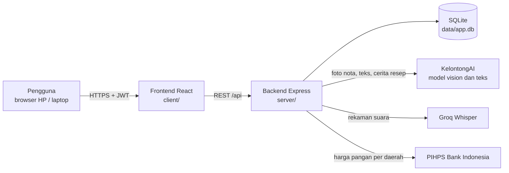
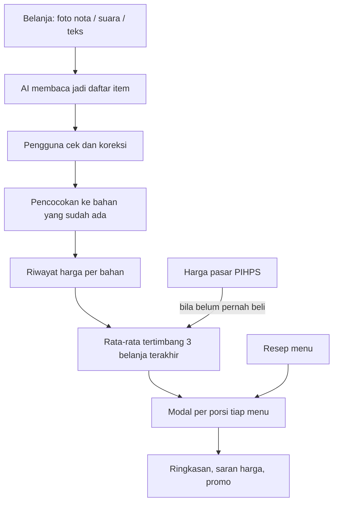

# Takarin AI

Aplikasi web untuk menghitung modal per porsi (HPP) usaha kuliner kecil dari nota belanja sehari-hari, lalu memberi saran harga jual dan paket promo yang tetap untung.

## Tim

- **Nama tim:** _(isi nama tim)_
- **Anggota:**
  - Ramadeva ([@Ramadeva1101](https://github.com/Ramadeva1101))
  - _(isi anggota lain)_

## Kategori dan deskripsi

- **Kategori:** Web
- **Subtema:** UMKM
- **Aplikasi:** Takarin AI

### Masalah

Banyak pemilik warung dan usaha kuliner rumahan menetapkan harga jual dengan perkiraan. Harga bahan berubah hampir tiap minggu dan dibeli di toko yang berbeda-beda, sedangkan resep ditulis dengan takaran rumah tangga (sendok, siung, potong). Akibatnya modal per porsi jarang dihitung ulang, dan margin bisa habis tanpa disadari.

### Solusi

Takarin AI mencatat belanja dari foto nota, suara, atau teks, mencocokkan setiap bahan ke resep menu, lalu menghitung ulang modal per porsi setiap kali ada harga baru. Kalau bahan belum pernah dibeli, harga diambil dari data harga pangan PIHPS Bank Indonesia untuk daerah usaha.

### Target pengguna

Pemilik usaha kuliner kecil (warung makan, katering rumahan, penjual takjil, kedai minuman) yang belum memakai pembukuan digital.

## Fitur yang sudah berjalan

- **Daftar dan masuk** dengan email dan kata sandi (JWT).
- **Onboarding:** jenis usaha, wilayah (provinsi dan kota dari PIHPS), target untung, hari buka per bulan, dan biaya rutin.
- **Menu dan resep:**
  - Isi manual, atau ceritakan resep lewat suara atau teks lalu disusun AI.
  - Takaran bebas: gram, sdm, siung, butir, potong, ikat.
  - Setiap bahan langsung menunjukkan harga yang dipakai dan sumbernya.
- **Catat belanja:**
  - Foto nota dibaca AI, atau isi lewat suara atau teks.
  - Hasil dicek pengguna sebelum disimpan.
  - Harga yang janggal (di bawah 50% atau di atas 200% pembanding) diberi peringatan.
- **Pencocokan bahan:**
  - Satu aturan untuk resep dan belanja ("cabe rawit" = "cabai rawit", "gula merah" berbeda dari "gula pasir").
  - Nama yang hanya mirip ditanyakan dulu ke pengguna.
  - Bahan ganda bisa digabung.
- **Modal per porsi (HPP):**
  - Harga bahan diambil dari rata-rata tertimbang tiga belanja terakhir (bobot 3:2:1).
  - Kalau belum pernah dibeli, dipakai harga pasar.
  - Kalau keduanya tidak ada, menu diberi tanda belum lengkap.
- **Harga pasar:** 13 komoditas dari PIHPS Bank Indonesia, tingkat kota, provinsi, lalu nasional, dengan grafik 30 hari.
- **Ringkasan:** untung per menu dibanding target, catatan harian satu kalimat, dan saran harga jual yang bisa langsung dipakai.
- **Simulasi harga** per menu.
- **Promo paket:**
  - Hitung harga paket yang tetap untung.
  - Usulan nama dan caption dari AI.
  - Caption dicek agar tidak menyebut harga lain.
  - Paket tersimpan bisa diubah dan dibagikan ke WhatsApp.

## Teknologi

| Bagian | Yang dipakai |
|---|---|
| Frontend | React 19, Vite, React Router, Tailwind CSS v4, Recharts, Phosphor Icons, browser-image-compression |
| Backend | Node.js 24, Express 5, zod, bcrypt, jsonwebtoken, multer, simple-statistics |
| Database | SQLite bawaan Node (`node:sqlite`) |
| AI | KelontongAI (gateway model, API kompatibel OpenAI) dan Groq (Whisper) |
| Data pihak ketiga | PIHPS Bank Indonesia (bi.go.id/hargapangan) |
| Pengujian | Vitest |

## Arsitektur dan alur data



Alur utama:



Semua angka (modal, untung, harga saran) dihitung oleh kode di `server/src/domain/`. AI hanya membaca input dan merangkai kalimat. Angka yang ditulis AI dicek ulang terhadap hasil hitungan sebelum ditampilkan.

Struktur folder:

```
client/            Frontend React (Vite)
  src/pages/       Halaman aplikasi
  src/components/  Komponen bersama
server/            Backend Express
  src/domain/      Logika hitungan murni (HPP, satuan, pencocokan, promo)
  src/services/    Akses database dan alur fitur
  src/ai/          Pemanggilan model AI, prompt, skema hasil, fixture
  src/routes/      Endpoint REST dan validasi
  scripts/         Seed akun demo dan impor harga CSV
  tests/           Tes unit dan API
```

## Cara menjalankan

Kebutuhan: **Node.js 24** (atau 22.5 ke atas, karena memakai `node:sqlite`) dan npm.

1. Pasang dependensi:

   ```bash
   npm install
   npm --prefix server install
   npm --prefix client install
   ```

2. Salin file lingkungan, lalu isi nilainya:

   ```bash
   cp server/.env.example server/.env
   ```

3. Isi database dengan akun demo dan data contoh:

   ```bash
   npm run seed
   ```

4. Jalankan untuk pengembangan (server di port 3001, client di port 5173):

   ```bash
   npm run dev
   ```

   Buka http://localhost:5173.

5. Mode produksi (satu port, server menyajikan hasil build client):

   ```bash
   npm run build
   npm --prefix server start
   ```

   Buka http://localhost:3001.

6. Menjalankan tes:

   ```bash
   npm test
   ```

### Variabel lingkungan (`server/.env`)

| Variabel | Keterangan |
|---|---|
| `AI_MODE` | `fixture` = tanpa AI (memakai contoh jawaban, cocok untuk tes). `live` = memanggil model AI. |
| `PORT` | Port server, bawaan 3001. |
| `JWT_SECRET` | String acak panjang untuk menandatangani token masuk. |
| `DB_PATH` | Lokasi file SQLite, bawaan `./data/app.db`. |
| `KELONTONG_BASE_URL` | Alamat API KelontongAI. |
| `KELONTONG_API_KEY` | Kunci API KelontongAI. Wajib untuk `AI_MODE=live`. |
| `MODEL_NOTA`, `MODEL_NOTA_FALLBACK` | Model pembaca foto nota dan cadangannya (dipisah koma). |
| `MODEL_TEKS`, `MODEL_TEKS_FALLBACK` | Model teks untuk resep, ucapan, promo, dan catatan harian. |
| `GROQ_API_KEY` | Kunci Groq untuk mengubah rekaman suara jadi teks. Dipakai hanya bila browser tidak punya pengenal suara bawaan. |
| `HARGA_LIVE` | `on` = ambil harga dari PIHPS. Kosongkan untuk memakai data tersimpan saja. |

Tanpa kunci API, aplikasi tetap bisa dicoba dengan `AI_MODE=fixture`. Semua fitur hitungan berjalan normal.

## Akun demo

| Email | Kata sandi |
|---|---|
| `demo@dapur.id` | `demo12345` |

Akun ini dibuat oleh `npm run seed` dan berisi menu, resep, serta riwayat belanja contoh.

## Penggunaan AI

| Bagian produk | Layanan dan model | Tugas |
|---|---|---|
| Catat belanja dari foto nota | KelontongAI: `qwen3.8-flash`, cadangan `gpt-5.6-luna`, `minimax-m3.1-flash` | Membaca nama barang, jumlah, satuan, dan harga dari foto nota |
| Catat belanja dari ucapan atau teks, susun resep dari cerita, cek jenis usaha | KelontongAI: `glm-5.3-flash`, cadangan `deepseek-v4-flash` | Mengubah kalimat bebas menjadi data terstruktur |
| Usulan nama dan caption promo | KelontongAI: `glm-5.3-flash` | Menulis nama paket dan caption; harga di caption dicek ulang |
| Catatan harian di Ringkasan | KelontongAI: `glm-5.3-flash` | Merangkai satu kalimat dari fakta yang sudah dihitung kode |
| Input suara (cadangan) | Groq: `whisper-large-v3-turbo` | Mengubah rekaman suara menjadi teks |

Hasil AI selalu divalidasi dengan skema zod. Pengguna memeriksa hasil bacaan sebelum data disimpan, dan semua hitungan uang dilakukan oleh kode, bukan oleh model. Bila semua model gagal, aplikasi memakai templat atau meminta input manual.

Selama pengembangan, tim juga memakai asisten koding AI sebagai alat bantu menulis dan meninjau kode. Seluruh kode diperiksa, diuji, dan dipertanggungjawabkan oleh tim.

## Atribusi

- **Data harga pangan:** [PIHPS Nasional, Bank Indonesia](https://www.bi.go.id/hargapangan). Data diambil paling sering sekali per wilayah dalam beberapa jam, disimpan di database, dan sumbernya selalu ditampilkan di aplikasi.
- **Huruf:** [Plus Jakarta Sans](https://github.com/tokotype/PlusJakartaSans) oleh Tokotype (SIL Open Font License), lewat paket `@fontsource-variable/plus-jakarta-sans`.
- **Ikon:** [Phosphor Icons](https://phosphoricons.com) (MIT).
- **Grafik:** [Recharts](https://recharts.org) (MIT).
- **Logo:** dibuat oleh tim.
- **Pustaka open-source lain:** tercantum di `client/package.json` dan `server/package.json`, masing-masing dengan lisensinya sendiri.
- Tidak memakai template aplikasi jadi.
