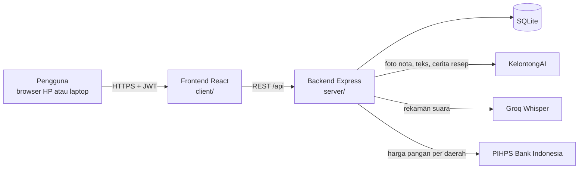
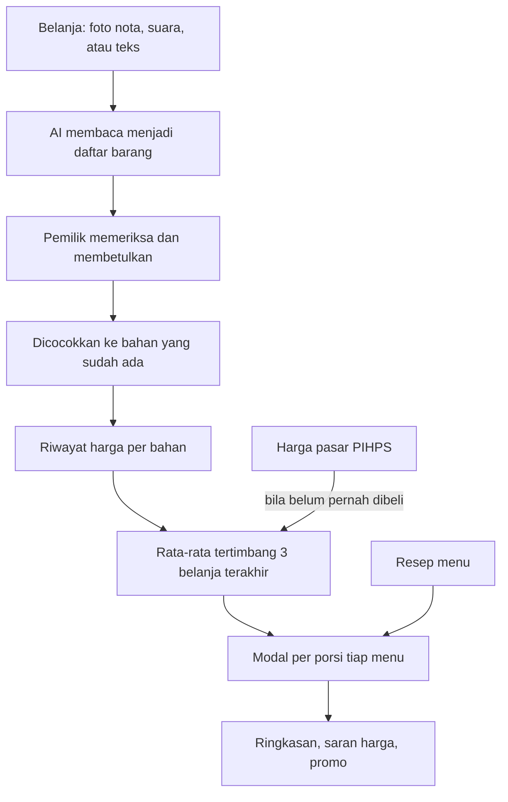

# Takarin AI

Takarin AI membantu pemilik warung dan usaha kuliner rumahan mengetahui modal setiap porsi menu (HPP), langsung dari nota belanja. Dari modal itu aplikasi menghitung harga jual minimal sesuai target untung, dan bisa menyusun paket promo yang tidak merugi.

Kategori Web, subtema UMKM. Dibuat untuk LOGICODIX 2026.

## Tim Sukses Djaya Abadi

| Nama | NIM | Peran |
|---|---|---|
| I Gede Ramadeva | 2501010025 | Ketua |
| Alan Brian Frederick | 2501010023 | Anggota |
| Ni Rai Putri Novianti | 2501010008 | Anggota |
| Ken Jatikusumo | 2501010034 | Anggota |

## Masalah yang kami angkat

**Menghitung HPP (modal per porsi) itu ribet, sehingga kebanyakan UMKM kuliner tidak melakukannya.** Harga jual akhirnya ditentukan dengan perkiraan sekali di awal, lalu jarang dihitung ulang.

Ada tiga hal yang membuatnya ribet:

1. **Takaran warung tidak memakai gram.** Resepnya pakai sendok, siung, dan potong, sedangkan kalkulator HPP dan template Excel meminta semua bahan dalam gram atau kilogram.
2. **Harga bahan berubah setiap minggu.** HPP yang dihitung bulan lalu sudah tidak berlaku, jadi hitungannya harus diulang dari awal.
3. **Semua alat yang ada meminta isian manual.** Nota belanja harus disalin ke tabel baris per baris, termasuk satuan beli yang berbeda dengan satuan resep (beli per papan, pakai per potong).

Dampaknya tidak terasa per porsi, tetapi terasa per bulan. Contohnya, cabai rawit merah di Denpasar naik 10,6% dalam seminggu menurut PIHPS Bank Indonesia. Untuk ayam geprek yang memakai 20 gram cabai, itu tambahan sekitar Rp170 per porsi, atau sekitar Rp255.000 sebulan untuk 50 porsi sehari, dari satu bahan saja.

Beberapa penelitian tentang UMKM kuliner menemukan pola yang sama: harga ditetapkan dengan perkiraan, dan biaya seperti gas, listrik, dan tenaga kerja sering terlewat. Sumbernya kami kumpulkan di [docs/dasar-perhitungan.md](docs/dasar-perhitungan.md).

## Solusi

Takarin AI menyederhanakan perhitungan HPP menjadi tiga langkah yang mengikuti kebiasaan pemilik warung:

1. **Catat belanja.** Foto nota, ucapkan, atau ketik belanjaan. Nota tulisan tangan dan singkatan seperti "cbe rwt" tetap terbaca, dan hasilnya diperiksa pemilik sebelum disimpan.
2. **Ceritakan menu.** Resep cukup diceritakan seperti menjelaskan ke karyawan, dengan takaran sendok, siung, atau potong. Setiap bahan langsung tersambung ke harga belanja.
3. **Lihat modal dan untung.** Modal per porsi, untung, dan harga jual minimal langsung terlihat, lalu dihitung ulang otomatis setiap kali belanja baru dicatat.

Kalau sebuah bahan belum pernah dibeli, aplikasi memakai harga pasar di kota usaha dari PIHPS Bank Indonesia. Kalau bahan itu juga tidak ada di data pasar (tahu, kecap, sosis, dan sejenisnya), pemilik diminta mengisi harga beli terakhirnya. Harga perkiraan itu otomatis diganti begitu belanja sungguhan dicatat.

Sasaran penggunanya pemilik warung makan, kedai minuman, katering rumahan, dan penjual jajanan yang belum memakai pembukuan digital.

## Apa bedanya dengan cara yang sudah ada

| | Template Excel atau kalkulator HPP | Aplikasi kasir dan inventori | Takarin AI |
|---|---|---|---|
| Cara memasukkan resep | Isi tabel, semua dalam gram | Isi form per bahan | Ceritakan atau ucapkan, lalu periksa hasilnya |
| Takaran sendok, siung, potong | Harus dikonversi sendiri | Umumnya harus dikonversi sendiri | Dikonversi otomatis dengan tabel URT, bisa diubah per bahan |
| Harga bahan diperbarui | Diketik ulang manual | Dari input pembelian lewat form | Dari foto nota, suara, atau ketikan bebas |
| Bahan yang belum pernah dibeli | Kosong | Kosong | Harga pasar kota dari PIHPS Bank Indonesia |
| Modal semua menu ikut berubah | Tidak, harus dibuka satu per satu | Tergantung aplikasi | Ya, setiap kali belanja dicatat |
| Saran harga jual dan promo yang tidak rugi | Tidak ada | Biasanya tidak ada | Ada, dengan batas harga minimal |
| Biaya | Gratis, tetapi semua manual | Umumnya berlangganan dan dirancang untuk usaha yang sudah memakai kasir | Hanya butuh HP dan browser |

Takarin tidak menggantikan rumus HPP yang sudah baku. Rumus yang dipakai sama dengan buku dan jurnal costing, dan semua angka uang dihitung oleh kode, bukan oleh AI. Yang berbeda adalah cara datanya masuk. AI mengubah nota, suara, dan cerita menjadi data, sehingga pemilik warung tidak perlu mengisi tabel. Hasil bacaan AI selalu diperiksa pemilik sebelum disimpan, dan kalau AI sedang tidak tersedia, semua hitungan dan isian manual tetap berjalan.

## Fitur yang sudah jalan

1. Daftar dan masuk dengan email. Ada akun demo untuk mencoba tanpa mendaftar.
2. Onboarding: jenis usaha (jenis di luar daftar diperiksa AI), provinsi dan kota, target untung, porsi per hari, hari buka per bulan, serta biaya rutin seperti gas, listrik, sewa, gaji, dan penyusutan alat.
3. Menu dan resep. Bisa diisi manual atau diceritakan lalu disusun AI. Takaran boleh memakai gram, sdm, siung, butir, potong, bungkus, atau ikat. Setiap bahan langsung menunjukkan harga yang dipakai dan asalnya.
4. Catat belanja dari foto nota, ucapan, ketikan, atau tabel. Hasil bacaan selalu diperiksa pemilik dulu. Harga yang terlalu jauh dari belanja sebelumnya atau dari harga pasar diberi peringatan.
5. Pencocokan bahan. Resep dan nota memakai aturan yang sama, jadi "cbe rwt" di nota tetap masuk ke "cabai rawit" di resep. Nama yang hanya mirip harus dipastikan dulu oleh pemilik, dan bahan yang tercatat dua kali bisa digabung.
6. Satuan kemasan. "1 papan tempe = 10 potong" atau "1 kaleng susu kental manis = 18 sdm" cukup diisi sekali per bahan.
7. Modal per porsi. Harga bahan memakai rata-rata tertimbang tiga belanja terakhir, ditambah susut bahan dan bagian biaya rutin per porsi.
8. Harga pasar dari PIHPS Bank Indonesia untuk 13 jenis bahan pokok, di tingkat kota, provinsi, atau nasional, lengkap dengan grafik 30 hari. Setiap bahan diberi arah harga (cenderung naik, turun, atau stabil) dari garis tren 30 hari, ditambah catatan bila sedang menjelang hari besar seperti Natal atau Lebaran. Ini bukan ramalan angka, dan aplikasi menyatakannya begitu.
9. Ringkasan: untung tiap menu dibanding target, catatan harian satu kalimat, dan saran harga jual yang bisa langsung dipakai.
10. Coba-coba harga jual dan takaran per menu sebelum dipakai.
11. Promo paket. Aplikasi memberi pilihan harga paket yang tidak rugi, menunjukkan berapa paket yang perlu terjual agar untung tidak turun, dan mengusulkan nama serta caption WhatsApp. Paket rugi tidak bisa disimpan.

## Teknologi

| Bagian | Yang dipakai |
|---|---|
| Frontend | React 19, Vite, React Router, Tailwind CSS 4, Recharts, Phosphor Icons, browser-image-compression |
| Backend | Node.js 24, Express 5, zod, bcrypt, jsonwebtoken, multer |
| Database | SQLite bawaan Node (`node:sqlite`) |
| AI | KelontongAI (gateway model dengan API yang kompatibel OpenAI), Groq Whisper untuk suara |
| Data luar | PIHPS Nasional, Bank Indonesia |
| Tes | Vitest, 60 tes unit dan API |

## Arsitektur



Alur data utama:



Semua angka uang dihitung oleh kode di `server/src/domain/`, bukan oleh AI. AI hanya dipakai untuk membaca masukan dan menulis kalimat. Kalau AI menulis angka yang tidak ada di hasil hitungan, kalimatnya dibuang dan diganti teks baku. Rumus lengkap beserta sumbernya ada di [docs/dasar-perhitungan.md](docs/dasar-perhitungan.md).

```
client/            frontend React
  src/pages/       halaman aplikasi
  src/components/  komponen bersama
server/            backend Express
  src/domain/      rumus murni: HPP, satuan, pencocokan nama, promo
  src/services/    akses database dan alur fitur
  src/ai/          pemanggilan model, prompt, skema hasil, contoh jawaban
  src/routes/      endpoint REST dan validasi
  scripts/         isi data demo dan impor harga CSV
  tests/           tes unit dan API
docs/              dasar perhitungan dan sumber
```

## Dokumentasi frontend

Frontend ada di `client/`, dibuat dengan **React 19** dan **Vite**. Navigasi memakai **React Router**, tampilan memakai **Tailwind CSS 4**, grafik memakai **Recharts**, dan ikon memakai **Phosphor Icons**. Foto nota diperkecil di browser dengan `browser-image-compression` sebelum diunggah.

### Halaman (`client/src/pages/`)

| File | Rute | Isi |
|---|---|---|
| `Publik.jsx` | `/`, `/tentang`, `/bantuan`, `/privasi`, `/syarat` | Beranda untuk tamu, halaman informasi, dan pusat bantuan |
| `Masuk.jsx` | `/masuk`, `/daftar` | Masuk dan daftar akun, termasuk tombol akun demo |
| `Onboarding.jsx` | `/mulai` | Empat pertanyaan awal: jenis usaha, lokasi, penjualan, biaya rutin |
| `Dashboard.jsx` | `/` (sesudah masuk) | Ringkasan untung per menu, harga pasar bahan, catatan harian, saran harga |
| `BelanjaBaru.jsx` | `/belanja/baru` | Catat belanja dari foto nota, ucapan, ketikan, atau tabel |
| `BelanjaCek.jsx` | `/belanja/:id` | Memeriksa hasil bacaan sebelum disimpan, lalu dampaknya ke modal menu |
| `Belanja.jsx` | `/belanja` | Riwayat belanja |
| `ProdukBaru.jsx` | `/produk/baru` | Tambah menu dengan bercerita atau isi manual |
| `ProdukDetail.jsx` | `/produk/:id` | Modal per porsi, rincian bahan, coba-coba harga dan takaran |
| `Produk.jsx` | `/produk` | Daftar menu |
| `Bahan.jsx`, `BahanDetail.jsx` | `/bahan`, `/bahan/:id` | Daftar bahan baku, riwayat harga, susut, dan isi kemasan |
| `Pasar.jsx` | `/pasar` | Harga pasar PIHPS per kota beserta arah harga 30 hari |
| `Promo.jsx` | `/promo` | Promo paket dengan pilihan harga yang tidak rugi |
| `Pengaturan.jsx` | `/pengaturan` | Profil usaha, target untung, dan biaya rutin |

### Komponen dan modul bersama

| Lokasi | Isi |
|---|---|
| `components/ui.jsx` | Komponen dasar: tombol, kartu, isian, isian rupiah, chip status |
| `components/Layout.jsx` | Kerangka aplikasi: menu samping di laptop, menu bawah di HP |
| `components/ResepEditor.jsx` | Editor resep yang menghubungkan tiap bahan ke harga belanja |
| `components/IsiSatuan.jsx` | Pertanyaan isi kemasan, misalnya "1 papan = 10 potong" |
| `components/BiayaRutin.jsx` | Isian biaya rutin seperti gas, listrik, dan sewa |
| `components/Dikte.jsx` | Rekam suara untuk diubah menjadi teks |
| `components/Chart.jsx`, `Grafik.jsx`, `Garis.jsx` | Grafik harga dan untung |
| `lib/api.js` | Pemanggilan API, penyimpanan token, format rupiah dan tanggal |
| `lib/auth.jsx` | Status login dan data usaha |
| `lib/cocok.js`, `lib/harga.js`, `lib/jenis.js`, `lib/hooks.js` | Pencocokan nama bahan, format harga, daftar jenis usaha, hook data |

### Aset (`client/public/`)

Logo (`logo-takarin.webp`, `logo-tanda.webp`, `logo-asli.webp`), ikon tab (`favicon.png`), dan tangkapan layar aplikasi untuk beranda (`tangkapan-ringkasan.webp`, `langkah-belanja.webp`, `langkah-menu.webp`, `langkah-modal.webp`). Semua gambar dibuat sendiri dari aplikasi ini.

## Dokumentasi backend

Backend ada di `server/`, dibuat dengan **Express 5** di **Node.js**. Database memakai **SQLite** bawaan Node (`node:sqlite`), input divalidasi dengan **zod**, password disimpan dengan **bcrypt**, login memakai **JWT**, dan unggahan file memakai **multer**.

### Endpoint API

Semua endpoint diawali `/api`. Kecuali daftar dan masuk, setiap permintaan wajib membawa header `Authorization: Bearer <token>`. Selain `/auth/*`, `/pasar/provinsi`, `/pasar/kota`, `/suara/teks`, `/usaha/cek-jenis`, `/usaha/cerita`, dan `/usaha/setup`, endpoint juga mewajibkan pertanyaan awal usaha sudah selesai diisi.

| Kelompok | Endpoint | Kegunaan |
|---|---|---|
| Akun | `POST /auth/daftar`, `POST /auth/masuk`, `GET /auth/saya` | Daftar, masuk, dan data akun yang sedang masuk |
| Usaha | `POST /usaha/setup`, `GET /usaha`, `PUT /usaha`, `PUT /usaha/biaya` | Pertanyaan awal, profil usaha, biaya rutin |
| Usaha (AI) | `POST /usaha/cek-jenis`, `POST /usaha/cerita` | Memeriksa jenis usaha di luar daftar, menyusun resep dari cerita |
| Suara | `POST /suara/teks` | Rekaman suara menjadi teks |
| Ringkasan | `GET /dashboard`, `GET /dashboard/catatan` | Data halaman Ringkasan dan catatan harian |
| Menu | `GET /produk`, `POST /produk`, `GET /produk/:id`, `PUT /produk/:id`, `DELETE /produk/:id` | Kelola menu dan resep |
| Menu | `POST /produk/:id/simulasi`, `GET /produk/:id/rekomendasi` | Coba-coba harga dan takaran, saran harga jual |
| Belanja | `POST /pembelian/foto`, `POST /pembelian/suara`, `POST /pembelian/teks`, `POST /pembelian/manual` | Membuat draf belanja dari foto, suara, teks, atau tabel |
| Belanja | `GET /pembelian`, `GET /pembelian/:id`, `PUT /pembelian/:id`, `DELETE /pembelian/:id` | Riwayat, periksa dan simpan draf, hapus belanja |
| Bahan | `GET /bahan`, `GET /bahan/:id`, `PUT /bahan/:id`, `POST /bahan/cocokkan` | Daftar bahan, detail, ubah, cocokkan nama |
| Bahan | `POST /bahan/:id/gabung`, `POST /bahan/:id/harga`, `POST /bahan/:id/isi`, `POST /bahan/:id/konversi` | Gabung bahan ganda, harga manual, isi kemasan, konversi satuan |
| Harga pasar | `GET /pasar`, `POST /pasar/perbarui`, `GET /pasar/provinsi`, `GET /pasar/kota` | Harga PIHPS untuk kota usaha dan daftar wilayah |
| Promo | `POST /promo/hitung`, `POST /promo/saran`, `GET /promo`, `POST /promo`, `PUT /promo/:id`, `DELETE /promo/:id` | Hitung pilihan harga paket, usulan nama dan caption, simpan paket |
| Lain | `GET /health` | Cek server hidup |

Kesalahan dikembalikan dalam bentuk `{ "pesan": "..." }` dengan kode HTTP yang sesuai: 400, 401, 404, 409, 429, atau 503 bila layanan AI tidak tersedia.

### Skema database

Didefinisikan di `server/src/lib/schema.sql`. Semua data usaha ikut terhapus bila akunnya dihapus (`ON DELETE CASCADE`).

| Tabel | Kolom utama | Isi |
|---|---|---|
| `users` | `email`, `password_hash`, `nama` | Akun pengguna |
| `usaha` | `user_id`, `nama`, `jenis`, `kota`, `provinsi`, `target_margin`, `porsi_per_hari`, `hari_buka`, `setup_selesai` | Profil usaha, satu per akun |
| `bahan` | `usaha_id`, `nama`, `satuan_dasar`, `komoditas`, `susut_persen` | Bahan baku milik usaha |
| `alias_bahan` | `bahan_id`, `istilah` | Nama lain bahan, misalnya "cbe rwt" untuk cabai rawit |
| `konversi_satuan` | `bahan_id`, `satuan`, `faktor` | Isi kemasan, misalnya 1 papan = 10 potong |
| `nota`, `nota_item` | `tanggal`, `sumber`, `status`; `nama_bahan`, `qty`, `satuan`, `harga`, `bahan_id` | Catatan belanja dan barisnya |
| `harga_bahan` | `bahan_id`, `harga_per_satuan`, `tanggal`, `sumber`, `nota_id` | Riwayat harga per bahan dari belanja |
| `harga_pasar` | `komoditas`, `wilayah`, `level`, `harga`, `tanggal`, `sumber` | Harga PIHPS Bank Indonesia |
| `menu`, `resep_item` | `nama`, `harga_jual`, `porsi_per_batch`; `bahan_id`, `qty`, `satuan` | Menu dan resepnya |
| `biaya_lain` | `nama`, `nominal`, `periode` | Biaya rutin seperti gas, listrik, sewa |
| `promo`, `promo_item` | `nama`, `harga_paket`, `biaya_kemasan`, `caption`; `menu_id`, `qty` | Paket promo dan isinya |

Contoh isi konfigurasi ada di `server/.env.example`. Penjelasan tiap variabelnya ada di bagian Variabel lingkungan di bawah.

## Menjalankan di localhost

Butuh Node.js 24 (minimal 22.13, karena memakai `node:sqlite` tanpa flag tambahan) dan npm.

Pasang dependensi:

```bash
npm install
npm --prefix server install
npm --prefix client install
```

Salin file lingkungan, lalu isi kunci API-nya:

```bash
cp server/.env.example server/.env
```

Isi database dengan akun demo:

```bash
npm run seed
```

Jalankan untuk pengembangan. Server ada di port 3001 dan tampilan di http://localhost:5173.

```bash
npm run dev
```

Atau jalankan seperti di produksi, dengan satu port di http://localhost:3001:

```bash
npm run build
npm --prefix server start
```

Menjalankan tes:

```bash
npm test
```

### Variabel lingkungan (`server/.env`)

| Variabel | Kegunaan |
|---|---|
| `AI_MODE` | `live` memanggil model AI. `fixture` memakai contoh jawaban tanpa AI, berguna untuk tes. |
| `PORT` | Port server, bawaan 3001. |
| `JWT_SECRET` | Teks acak panjang untuk menandatangani token masuk. |
| `DB_PATH` | Lokasi file SQLite, bawaan `./data/app.db`. |
| `KELONTONG_BASE_URL`, `KELONTONG_API_KEY` | Alamat dan kunci API KelontongAI. Kuncinya wajib untuk `AI_MODE=live`. |
| `MODEL_NOTA`, `MODEL_NOTA_FALLBACK` | Model pembaca foto nota dan cadangannya, dipisah koma. |
| `MODEL_TEKS`, `MODEL_TEKS_FALLBACK` | Model untuk resep, ucapan, cek jenis usaha, promo, dan catatan harian. |
| `AI_PARALEL` | Berapa permintaan AI yang boleh berjalan bersamaan. Bawaan 2, sesuai batas penyedia. |
| `GROQ_API_KEY` | Kunci Groq untuk mengubah rekaman suara menjadi teks. Hanya dipakai kalau browser tidak punya pengenal suara bawaan. |
| `HARGA_LIVE` | `on` mengambil harga dari PIHPS. Kosongkan untuk memakai data yang sudah tersimpan. |
| `DEMO_RESET` | `on` mengembalikan akun demo ke data awal setiap server dinyalakan dan setiap tengah malam. |

Tanpa kunci API, aplikasi tetap bisa dicoba dengan `AI_MODE=fixture`. Semua hitungan berjalan normal; hanya bacaan nota, suara, dan cerita yang memakai contoh jawaban.

## Akun demo

| Email | Kata sandi |
|---|---|
| `demo@dapur.id` | `demo12345` |

Isinya Warung Bu Sari di Denpasar dengan empat menu dan tiga catatan belanja. Karena akun ini dipakai bersama, datanya dikembalikan ke awal setiap tengah malam (`DEMO_RESET=on`). Untuk mengembalikannya secara manual tanpa menyentuh akun lain:

```bash
npm --prefix server run seed:demo
```

## Penggunaan AI

| Bagian aplikasi | Model (lewat KelontongAI) | Tugas |
|---|---|---|
| Catat belanja dari foto nota | `minimax-m3.1-flash`, cadangan `gpt-5.6-luna` dan `gpt-6-astra-ultrafast` | Membaca nama barang, jumlah, satuan, harga, dan tanggal |
| Catat belanja dari ucapan atau ketikan, susun resep dari cerita, cek jenis usaha | `deepseek-v4-flash`, cadangan `deepseek-v4-flash-0731`, `gpt-6-astra-ultrafast`, `glm-5.3-flash`, dan `gpt-5.6-luna` | Mengubah kalimat bebas menjadi data terstruktur |
| Nama dan caption promo, catatan harian, penjelasan modal | `deepseek-v4-flash` | Menulis kalimat dari angka yang sudah dihitung kode |
| Suara ke teks (cadangan) | Groq `whisper-large-v3-turbo` | Mengubah rekaman suara menjadi teks |

Model dipilih dari uji kecepatan dan ketepatan pada tugas yang sama dengan aplikasi. Contohnya, menyusun resep dari cerita butuh sekitar 3 detik dengan `deepseek-v4-flash`, dibanding 11 detik dengan `glm-5.3-flash`. Jawaban AI selalu diperiksa dengan skema zod sebelum dipakai. Bacaan nota, ucapan, dan cerita masuk ke halaman periksa dulu, jadi tidak ada data yang tersimpan tanpa persetujuan pemilik. Kalau semua model gagal, aplikasi memakai teks baku atau meminta isian manual.

Penggunaan AI juga dibatasi per akun (30 permintaan per 10 menit dan 300 per hari), supaya kuota tidak habis oleh satu pengguna.

Selama pengembangan, tim memakai asisten koding AI untuk membantu menulis dan meninjau kode. Seluruh kode diperiksa, diuji, dan dipertanggungjawabkan oleh tim.

## Atribusi

- Data harga pangan dari [PIHPS Nasional, Bank Indonesia](https://www.bi.go.id/hargapangan). Data diambil paling sering sekali per wilayah dalam enam jam, disimpan di database, dan sumber serta tanggalnya selalu ditampilkan di aplikasi.
- Huruf [Plus Jakarta Sans](https://github.com/tokotype/PlusJakartaSans) oleh Tokotype (SIL Open Font License), lewat paket `@fontsource-variable/plus-jakarta-sans`.
- Ikon [Phosphor Icons](https://phosphoricons.com) (MIT) dan grafik [Recharts](https://recharts.org) (MIT).
- Logo dibuat oleh tim.
- Pustaka open source lain tercantum di `client/package.json` dan `server/package.json`, masing-masing dengan lisensinya.
- Aplikasi ini tidak dibuat dari template aplikasi jadi.
